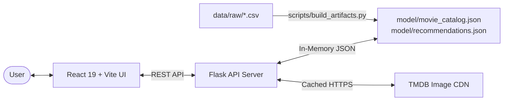

# CineMatch — Intelligent Movie Recommender System

CineMatch is a modern, high-performance, content-based movie recommendation platform. It combines a **React + Vite** frontend with a **Flask REST API** backend, powered by vector-based cosine similarity computed from the TMDB 5000 Movie Dataset.

---

## 🏗 System Architecture



- **Frontend (`frontend/`)**: React 19 SPA built with Vite. Features real-time movie search autocomplete, cinematic hero preview, interactive mood-to-genre matrix filtering, carousel recommendation pagination, and responsive cards.
- **Backend (`backend/`)**: Flask REST API providing fast in-memory catalog search, paginated recommendations with seamless wrap-around, health monitoring, and TMDB poster proxying with caching.
- **Model Artifacts (`model/`)**: Precomputed content vectors compiled into lightweight JSON artifacts (`movie_catalog.json` and `recommendations.json`) for sub-millisecond retrieval without runtime machine learning overhead.
- **Source Data (`data/raw/`)**: Raw TMDB 5000 movies and credits datasets used by maintenance scripts to regenerate artifacts.

---

## 📁 Repository Structure

```
Movie_recommender_system-main/
├── backend/
│   ├── app.py                     # Flask REST API application
│   ├── requirements.txt           # Backend runtime Python dependencies
│   ├── test_api.py                # Automated 91-point test suite for API endpoints
│   ├── .env                       # Local backend secrets (gitignored)
│   └── .env.example               # Backend environment template
├── data/
│   └── raw/
│       ├── tmdb_5000_credits.csv  # Canonical source dataset (cast & crew)
│       └── tmdb_5000_movies.csv   # Canonical source dataset (metadata & overviews)
├── frontend/
│   ├── public/                    # Static favicon and icon assets
│   ├── src/
│   │   ├── components/            # UI components (Hero, Navbar, MovieCard, etc.)
│   │   ├── services/              # API and poster service clients
│   │   ├── App.jsx                # Main application component
│   │   ├── App.css                # Application styling & layout
│   │   ├── index.css              # Global tokens and font styles
│   │   └── main.jsx               # React DOM entry point
│   ├── index.html                 # Single page application HTML shell
│   ├── package.json               # Frontend scripts and dependencies
│   ├── vite.config.js             # Vite configuration
│   ├── .env                       # Local frontend configuration (gitignored)
│   └── .env.example               # Frontend environment template
├── model/
│   ├── movie_catalog.json         # Search catalog and movie metadata (4,803 entries)
│   └── recommendations.json       # Precomputed top-20 similarity mappings
├── scripts/
│   ├── build_artifacts.py         # Rebuilds recommendation artifacts from raw CSVs
│   └── validate_artifacts.py      # Validates artifact schema, integrity, and test queries
├── .env.example                   # Root environment variables reference
├── .gitignore                     # Git ignore rules for secrets, builds, and caches
└── README.md                      # Project documentation
```

---

## 🚀 Getting Started

### Prerequisites

- **Python 3.10+**
- **Node.js 18+** & **npm**

### 1. Environment Setup

Create `.env` files from the provided examples:

```bash
# Root template
cp .env.example .env

# Or configure backend and frontend directly:
# Backend (backend/.env):
TMDB_API_KEY=your_tmdb_api_key_here

# Frontend (frontend/.env):
VITE_API_BASE_URL=http://127.0.0.1:5000
```

> **Note**: A free TMDB API key can be generated at [themoviedb.org](https://www.themoviedb.org/settings/api). The application runs with placeholder posters if no key is provided.

### 2. Backend Setup & Execution

```bash
# Install backend dependencies
pip install -r backend/requirements.txt

# Run the Flask REST API server (defaults to port 5000)
python backend/app.py
```

### 3. Frontend Setup & Execution

```bash
cd frontend

# Install dependencies
npm install

# Start Vite development server (defaults to port 5173)
npm run dev


### 4. Production Deployment

#### Backend (WSGI Server with Gunicorn)
```bash
# Run backend with Gunicorn (4 workers, port 5000)
gunicorn --workers 4 --bind 0.0.0.0:5000 backend.app:app
```

#### Frontend (Static Assets)
```bash
cd frontend
# Build production bundle
npm run build

# Preview locally or serve dist/ via Nginx, Caddy, or static host
npm run preview
```

---

## 🧪 Testing & Validation

### Backend REST API Tests

Run the comprehensive 91-assertion test suite covering healthchecks, search matching, pagination wrap-around, poster caching, and error handling:

```bash
python backend/test_api.py
```

### Recommendation Artifacts Validation

Validate JSON schemas, record counts, self-recommendation absence, and target test cases:

```bash
python scripts/validate_artifacts.py
```

### Frontend Production Build & Linting

```bash
cd frontend
npm run lint
npm run build
```

---

## 🛠 Maintenance & Artifact Rebuild Workflow

To re-index or regenerate `model/movie_catalog.json` and `model/recommendations.json` from `data/raw/`:

1. Ensure maintenance dependencies are installed:
   ```bash
   pip install pandas scikit-learn numpy
   ```
2. Execute the build script:
   ```bash
   python scripts/build_artifacts.py
   ```
3. Validate newly built artifacts:
   ```bash
   python scripts/validate_artifacts.py
   ```
